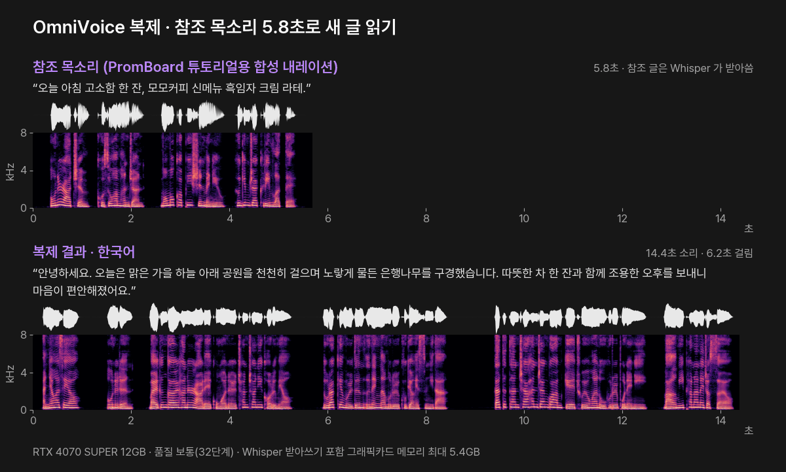
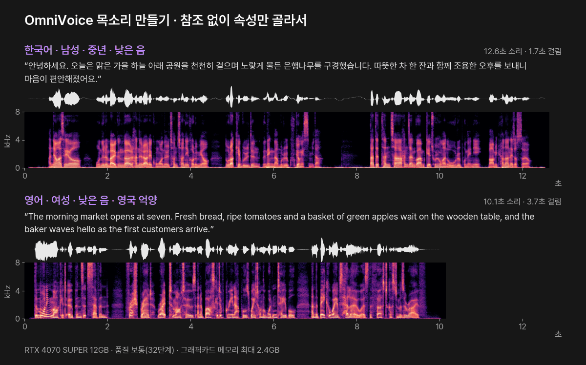
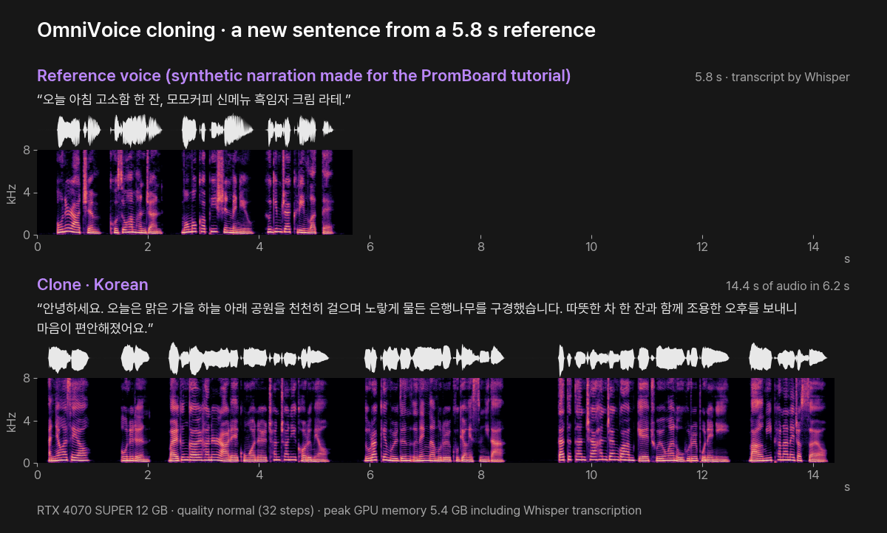
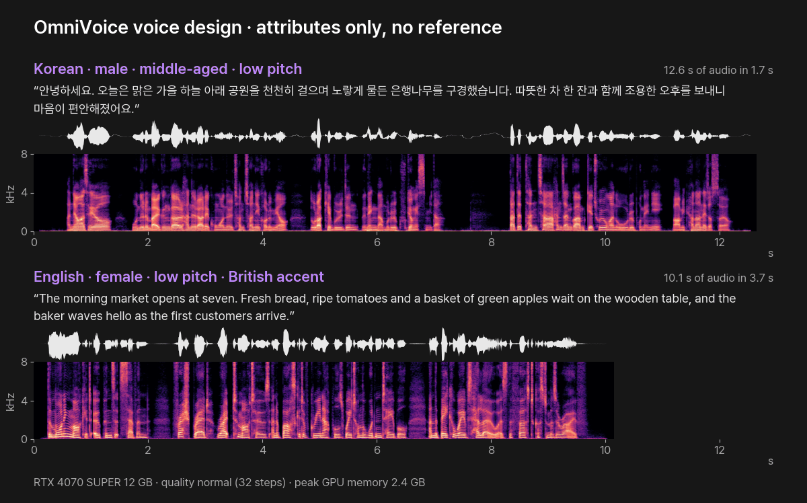

# OmniVoice — 목소리 복제 · 속성으로 목소리 만들기 (PromBoard 플러그인)

[English](#english)

글을 읽어 목소리(WAV)로 만드는 PromBoard 커뮤니티 플러그인입니다. k2-fsa 의 오픈 모델 [OmniVoice](https://github.com/k2-fsa/OmniVoice)(0.6B)를 이 PC 에서 돌립니다. 한국어를 포함해 600여 개 언어를 읽고, 목소리는 세 가지로 정합니다.

1. **복제**: 참조 목소리(3~10초 말소리)를 이으면 그 목소리로 읽습니다.
2. **목소리 만들기**: 참조 없이 성별 · 나이 · 음높이 · 속삭이기 · 영어 억양을 고르면 그 속성의 목소리를 만듭니다.
3. **자동**: 둘 다 없으면 모델이 목소리를 고릅니다.



위는 참조 목소리(PromBoard 튜토리얼용으로 만든 합성 내레이션 5.8초), 아래는 그 목소리로 새 한국어 글을 읽힌 결과입니다. 참조 글은 비워 두고 Whisper 가 받아쓰게 했습니다. 각 소리의 위 띠는 파형, 아래 띠는 스펙트로그램(가로 = 시간, 세로 = 소리 높낮이, 밝을수록 큰 소리)입니다. [참조 듣기](docs/ko/audio/reference-ko.mp3?raw=true) · [복제 결과 듣기](docs/ko/audio/clone-ko.mp3?raw=true)

- 플러그인 id: `promboard.omnivoice`
- 필요한 앱: PromBoard 1.0.2 이상
- 지원 언어: 600여 개(한국어 · 영어 · 일본어 · 중국어 등). 설정의 언어 목록은 자주 쓰는 18개이고, 자동으로 두면 다른 언어도 읽습니다.
- 라이선스: 플러그인 코드 Apache-2.0. 모델은 **비상업**(아래 「라이선스와 조건」)

## 받는 것과 용량

| 무엇 | 출처 | 크기 | 라이선스 |
|---|---|---|---|
| OmniVoice 본체 | [k2-fsa/OmniVoice](https://huggingface.co/k2-fsa/OmniVoice) | 2.46GB | CC-BY-NC |
| 소리 토크나이저(audio_tokenizer) | 같은 저장소 | 0.81GB | Boson Higgs Audio 2 Community License |
| Whisper large-v3-turbo (설정 '참조 글 받아쓰기' = Whisper 일 때만) | [openai/whisper-large-v3-turbo](https://huggingface.co/openai/whisper-large-v3-turbo) | 1.62GB | MIT |
| 파이썬 패키지(PyTorch 2.8 · transformers 등) | PyPI · PyTorch | 약 3GB(다른 플러그인과 같은 PyTorch 는 다시 받지 않습니다) | 각 패키지 |

## 필요한 그래픽카드 메모리

| 쓰는 방식 | 그래픽카드 메모리 최대(실측) |
|---|---|
| 자동 · 목소리 만들기 · 복제(참조 글 직접 잇기) | 2.4GB |
| 복제 + Whisper 받아쓰기 | 5.4GB |

그래픽카드가 없으면 CPU 로 돕니다. 이 PC(i7-14700K)에서 7초 소리에 약 28초(품질 빠르게는 약 12초) 걸렸습니다.

## 설치

1. PromBoard 홈 왼쪽 [플러그인] → 커뮤니티 플러그인에서 「OmniVoice」를 설치합니다. 비상업 모델이라 설치할 때 라이선스 안내를 확인합니다.
2. 커뮤니티 플러그인이라 제한 모드를 끄고 플러그인을 켭니다.
3. 처음 한 번 [실행 준비]를 누릅니다. 파이썬 · 패키지 · 모델(3.3GB)을 로컬 AI 모델 폴더에 받습니다.

## 쓰는 법

노드 추가 목록에서 「OmniVoice 목소리」를 놓고 글 노드를 '읽을 글'에 이은 뒤 ▷ 를 누릅니다.

| 입력 | 뜻 |
|---|---|
| 읽을 글 (필수) | 읽을 글. 5,000자까지. `[laughter]` · `[sigh]` · `[surprise-ah]` 같은 표시를 넣으면 그 자리에 웃음 · 한숨 · 놀람을 냅니다 |
| 참조 목소리 | 복제할 말소리 3~10초(1분까지). wav · mp3 · flac · ogg · m4a |
| 참조 글 | 참조 목소리에서 말한 글. 비우면 설정 '참조 글 받아쓰기'를 Whisper 로 바꿔야 합니다 |

| 설정 | 고르는 것 | 뜻 |
|---|---|---|
| 언어 | 자동 · 한국어 · 영어 · 일본어 · 중국어 등 18개 | 읽을 글의 언어. 알려 주면 조금 더 정확합니다 |
| 성별 · 나이 · 음높이 · 속삭이기 · 영어 억양 | 고르지 않음 또는 각 값 | 참조 목소리가 없을 때만 씁니다(목소리 만들기). 하나도 고르지 않으면 자동입니다. 영어 억양은 영어 글에만 맞습니다 |
| 빠르기 | 0.5 ~ 2 | 1 보다 크면 빠르게 읽습니다 |
| 길이 (초) | 0 ~ 600 | 0 이면 모델이 정하고, 값을 주면 그 길이에 맞춰 읽습니다(빠르기는 무시) |
| 품질 | 보통(32단계) · 빠르게(16단계) | 공식 권장 두 값입니다 |
| 참조 글 받아쓰기 | 직접 잇기 · Whisper 로 받아쓰기 | Whisper 를 고르면 처음 쓸 때 1.6GB 를 더 받습니다 |

목소리 만들기의 속성은 영어 · 중국어로만 학습됐습니다. 한국어 글에도 쓸 수 있지만 결과가 흔들릴 수 있습니다(공식 README). 가장 안정적인 것은 복제입니다.

## 실측

PromBoard 앱에서 실제로 돌려 쟀습니다(앱 1.0.3-beta 의 실행 경로 그대로, RTX 4070 SUPER 12GB · i7-14700K · Windows 11). 걸린 시간은 모델을 올린 뒤 소리를 만드는 시간입니다. 만든 소리를 Whisper large-v3-turbo 로 다시 받아써 원문과 글자 단위로 비교했습니다(글자 오류율, 0% 가 원문과 같음).



| 경우 | 글 | 만든 소리 | 걸린 시간 | 그래픽카드 메모리 최대 | 받아쓰기 비교 | 듣기 |
|---|---|---|---|---|---|---|
| 자동 · 한국어 | 93자 | 10.7초 | 1.1초 | 2.4GB | 0% | — |
| 목소리 만들기 · 한국어 · 남성 · 중년 · 낮은 음 | 93자 | 12.6초 | 1.7초 | 2.4GB | 0% | [듣기](docs/ko/audio/design-ko.mp3?raw=true) |
| 목소리 만들기 · 영어 · 여성 · 낮은 음 · 영국 억양 | 173자 | 10.1초 | 3.7초 | 2.3GB | 0% | [듣기](docs/ko/audio/design-en.mp3?raw=true) |
| 복제 · 한국어 · 참조 글은 Whisper 로 받아쓰기 | 93자 | 14.4초 | 6.2초 | 5.4GB | 1.5%(잔 → 장 한 글자) | [듣기](docs/ko/audio/clone-ko.mp3?raw=true) |
| CPU 만 · 한국어 · 자동(노드 코드 직접 실행) | 55자 | 7.2초 | 28.5초 | — | 0% | — |

- 처음 실행할 때는 모델을 올리는 데 1~2분, 첫 생성은 그래픽카드 준비로 1~2분 더 걸렸습니다(디스크가 느리면 더). 그다음부터는 위 시간입니다.
- 소리를 쓰지 않으면 2분 뒤 앱이 모델을 내리고, 다음 실행 때 다시 올립니다.

## 라이선스와 조건

- **모델 가중치는 CC-BY-NC(비상업)** 입니다. 학습 데이터(Emilia)의 제약 때문입니다(공식 README 「License」). PromBoard 는 막지 않고 설치 때 안내하고, 결과물에 '비상업' 표시를 붙입니다.
- **소리 토크나이저는 [Boson Higgs Audio 2 Community License](https://huggingface.co/k2-fsa/OmniVoice/blob/main/audio_tokenizer/LICENSE)**(Llama 3 Community License 기반)를 따릅니다. 배포 · 서비스에 쓰면 "Built with Higgs Materials licensed from Boson AI" 표기, 연간 사용자 10만 명 초과는 Boson 의 별도 허가, 결과물로 다른 대형 언어 모델을 개선하는 것은 금지입니다.
- 허락 없는 목소리 복제 · 사칭 · 사기에 쓰는 것은 금지입니다(공식 고지). 실존 인물의 목소리는 본인 동의 없이 복제하지 않습니다.
- 플러그인 코드(`nodes/main.py`)는 Apache-2.0 입니다.

## 파일

```
manifest.json                 플러그인 정보 · 노드 정의 · 받을 모델
icon.png
nodes/main.py                 노드 코드
nodes/requirements.in         직접 쓰는 패키지
nodes/excludes.txt            잠금 파일에서 뺀 패키지(gradio 등 노드가 쓰지 않는 것)
nodes/requirements-*.txt      운영체제별 해시 잠금 파일(uv pip compile --generate-hashes, Python 3.12)
docs/                         이 README 의 그림 · 소리(ko · en). 플러그인 zip 에는 넣지 않는다
docs/scripts/                 위 그림 · mp3 를 노드 결과 WAV 로 다시 만드는 스크립트(make_visuals.py)와 그림별 설정(hero.json · design.json)
```

README 그림 · 소리 다시 만들기: 노드 결과 WAV 를 설정 파일의 `wav` 이름으로 docs/scripts 에 두고(참조는 24kHz WAV 로 바꿔서) `python docs/scripts/make_visuals.py docs/scripts/hero.json docs ko` 처럼 그림 · 언어마다 실행합니다(numpy · scipy · matplotlib · Pillow · ffmpeg · Pretendard 글꼴).

레지스트리에 올리는 zip 은 PromBoard 앱 저장소의 `server/src/tools/packPlugin.ts` 로 만듭니다. `git archive HEAD` 로 꺼낸 폴더를 넘기면 `.gitattributes` 의 `export-ignore` 로 `docs/` 가 빠집니다.

---

## English

**OmniVoice — voice cloning · voice design** is a PromBoard community plugin that turns text into speech (WAV) with k2-fsa's open [OmniVoice](https://github.com/k2-fsa/OmniVoice) model (0.6B), running on this PC. It reads 600+ languages including Korean. The voice comes from one of three modes:

1. **Clone**: connect a reference voice (3–10 s of speech) and it reads in that voice.
2. **Voice design**: without a reference, pick gender · age · pitch · whisper · English accent.
3. **Auto**: with neither, the model picks a voice.



Top: the reference voice (5.8 s of synthetic narration made for the PromBoard tutorial). Bottom: OmniVoice reading a new Korean sentence in that voice. The reference transcript was left empty and transcribed by Whisper. For each sound the upper strip is the waveform and the lower strip is the spectrogram (time to the right, pitch upward, brighter = louder). [Listen to the reference](docs/en/audio/reference-ko.mp3?raw=true) · [Listen to the clone](docs/en/audio/clone-ko.mp3?raw=true)

- Plugin id: `promboard.omnivoice`
- Requires PromBoard 1.0.2 or later
- Languages: 600+ (Korean, English, Japanese, Chinese, …). The language setting lists 18 common ones; Auto reads the others too.
- License: plugin code Apache-2.0. The model is **non-commercial** (see below).

### Downloads

| What | Source | Size | License |
|---|---|---|---|
| OmniVoice | [k2-fsa/OmniVoice](https://huggingface.co/k2-fsa/OmniVoice) | 2.46 GB | CC-BY-NC |
| Audio tokenizer | same repo | 0.81 GB | Boson Higgs Audio 2 Community License |
| Whisper large-v3-turbo (only when "reference transcription" = Whisper) | [openai/whisper-large-v3-turbo](https://huggingface.co/openai/whisper-large-v3-turbo) | 1.62 GB | MIT |
| Python packages (PyTorch 2.8, transformers, …) | PyPI · PyTorch | about 3 GB (PyTorch shared with other plugins is not downloaded again) | per package |

### GPU memory

| Mode | Peak GPU memory (measured) |
|---|---|
| Auto · voice design · cloning with a typed transcript | 2.4 GB |
| Cloning + Whisper transcription | 5.4 GB |

Without a graphics card it runs on the CPU: about 28 s for 7 s of audio on this PC (i7-14700K), about 12 s with quality "fast".

### Use

Add the **OmniVoice 목소리** node, connect a text node to **읽을 글** (text to read) and press ▷. Optional inputs: **참조 목소리** (reference voice, 3–10 s, up to 1 min; wav · mp3 · flac · ogg · m4a) and **참조 글** (its transcript). Without a transcript, set **참조 글 받아쓰기** to Whisper (downloads 1.6 GB once). Inline tags such as `[laughter]`, `[sigh]` and `[surprise-ah]` add non-verbal sounds.

Settings: language (Auto + 18), gender · age · pitch · whisper · English accent (voice design, used only without a reference), speed (0.5–2), duration in seconds (0 = auto; overrides speed), quality (normal = 32 steps, fast = 16 steps), reference transcription (manual · Whisper). The setting labels inside the app are in Korean for now (the plugin format takes one language). Voice design was trained on English and Chinese only and may be unstable for other languages; cloning is the most stable mode (official README).

### Measured

Measured inside the PromBoard app (the app's own run path, app 1.0.3-beta, RTX 4070 SUPER 12 GB, i7-14700K, Windows 11). Times are generation times after the model is loaded. Each result was transcribed back with Whisper large-v3-turbo and compared with the input text character by character (character error rate, 0% = identical).



| Case | Text | Audio | Time | Peak GPU memory | Transcription check | Listen |
|---|---|---|---|---|---|---|
| Auto · Korean | 93 chars | 10.7 s | 1.1 s | 2.4 GB | 0% | — |
| Voice design · Korean · male · middle-aged · low pitch | 93 chars | 12.6 s | 1.7 s | 2.4 GB | 0% | [listen](docs/en/audio/design-ko.mp3?raw=true) |
| Voice design · English · female · low pitch · British accent | 173 chars | 10.1 s | 3.7 s | 2.3 GB | 0% | [listen](docs/en/audio/design-en.mp3?raw=true) |
| Clone · Korean · reference transcript by Whisper | 93 chars | 14.4 s | 6.2 s | 5.4 GB | 1.5% (one syllable) | [listen](docs/en/audio/clone-ko.mp3?raw=true) |
| CPU only · Korean · auto (node code run directly) | 55 chars | 7.2 s | 28.5 s | — | 0% | — |

- On the first run, loading the model took 1–2 minutes and the first generation another 1–2 minutes for GPU warm-up (longer on a slow disk). After that the times are as above.
- When unused for 2 minutes the app unloads the model and loads it again on the next run.

### License and conditions

- **Model weights: CC-BY-NC (non-commercial)**, because of the training data (Emilia) — official README, "License". PromBoard does not block it; it shows a notice at install time and marks results as non-commercial.
- **Audio tokenizer: [Boson Higgs Audio 2 Community License](https://huggingface.co/k2-fsa/OmniVoice/blob/main/audio_tokenizer/LICENSE)** (based on the Llama 3 Community License): show "Built with Higgs Materials licensed from Boson AI" when you distribute or serve it, get a separate license above 100,000 annual active users, and do not use its outputs to improve other large language models.
- Unauthorized voice cloning, impersonation or fraud is prohibited (official disclaimer). Do not clone a real person's voice without consent.
- Plugin code (`nodes/main.py`): Apache-2.0.

The `docs/` folder holds the pictures and sounds for this README and is left out of the plugin zip (`git archive HEAD` + `export-ignore`).
